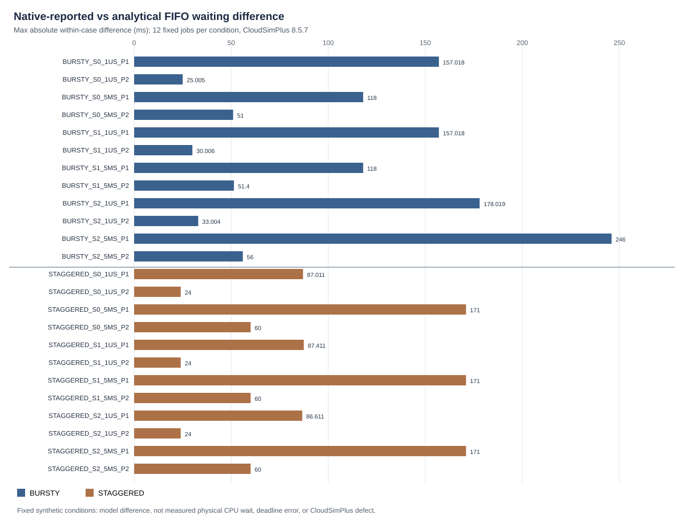

# Arrival and Execution-Time Accounting in CloudSimPlus 8.5.7 SpaceShared Scheduling: A Reproducible Reference-Model Comparison

## Abstract

Evaluation of cloud and edge scheduling methods often uses both discrete-event simulators and analytical queue references. These models should not be assumed to share identical admission or timing semantics. We present an explicitly bounded, reproducible comparison of CloudSimPlus 8.5.7 SpaceShared scheduling with an event-independent, capacity-matched FIFO reference. In a six-condition native Java microcase, passive instrumentation observed 54 eligibility callbacks and two configurations in which a later-submitted Cloudlet occupied the native execution list while an older Cloudlet remained waiting. A separately preregistered 24-condition experiment varied two synthetic arrival families, three deterministic timing variants, two minimum-event intervals and one/two processing elements; all 288 Cloudlets completed. We compare native-reported waiting times with a FIFO recurrence driven by actual native submission timestamps. Across the 24 cases, the maximum within-case absolute wait discrepancy ranged from 24 to 246 ms; classifications at synthetic submission-plus-25-ms and plus-50-ms deadlines differed for 86/288 and 107/288 jobs, respectively. A retrospective check found native-reported execution duration differed from requested duration for 250/288 jobs; substituting those after-completion durations into the reference left an across-case maximum discrepancy of 154 ms. A separate native audit verified that datacenter-arrival and scheduler-submit timestamps coincided for all 288 jobs in this configuration. These are model-dependent observations for fixed synthetic inputs, not proof of a simulator defect, general FIFO contract violation, scheduling-policy gain, or real-world deadline reliability.

**Keywords:** discrete-event simulation; SpaceShared scheduling; CloudSimPlus 8.5.7; queue waiting; simulator semantics; reproducibility.

## 1. Introduction

Deadline-aware dispatch is commonly studied through simulated cloud–edge computing environments, where a scheduling decision interacts with job arrivals, CPU capacity, queue admission and event processing. A basic methodological question is whether a queue abstraction used to estimate waiting time has the same operational meaning as the queue states and timing reported by a particular discrete-event simulator. If not, comparisons that differ only in timing or simulator event cadence can disagree even before evaluating a new scheduling algorithm.

This study is deliberately restricted to a single VM with one or two PEs, CPU-only Cloudlets, and fixed synthetic arrival patterns. The term *cloud–edge scheduling* motivates the broader evaluation problem, not a claim that a multi-node edge network, distributed placement algorithm or live IIoT system has been benchmarked here. The proposed contribution is therefore a version-specific **simulation measurement and reference-model comparison**, not a new scheduling algorithm or theorem.

We explicitly define a capacity-matched event-independent FIFO reference and test whether native Java CloudSimPlus 8.5.7 SpaceShared waiting-time measurements and synthetic deadline classifications match its outputs. Differences are reported as *model disagreements*, not by default inaccuracies of either model.

The evidence presented here consists of (i) an instrumented same-source native queue-admission study with concrete callback observations and an uninstrumented control, (ii) a preregistered multi-condition comparison of native queue-wait and deadline classification against a deliberately distinct capacity-matched analytical FIFO reference, and (iii) a transparent test of how native-reported execution durations confound this comparison. These are version-specific measurements, not claims of first discovery of model-fidelity or simulator-duration problems. The empirical scope is fixed synthetic workloads, not factory telemetry.

The originally submitted FGCS CASPER paper defines the scheduling policy, uncertainty certificates and queue-counterfactual limits; those mechanisms and findings are not presented as new in this study. Before any journal submission, a complete author-approved bibliography and an explicit overlap declaration for the earlier submission are required.

## 2. Related work

Simulation frameworks provide repeatable environments for studying provisioning and scheduling without full production deployment. Buyya et al. [1] introduced the CloudSim modeling toolkit for cloud-resource experiments. Silva Filho et al. [2] subsequently documented CloudSim Plus as a modular, extensible simulation framework. Our use of CloudSimPlus does not imply that a generic analytical FIFO waiting-time model and the published SpaceShared implementation in version 8.5.7 share identical timing or callback semantics. The versioned API explicitly documents configurable minimum event separation [5] and separate cloudlet admission and processing-update interfaces [6].

Verification, reproducibility and model validation are distinct methodological questions. Sargent [3] discusses the validation of simulation models, including conceptual, operational and data validity. In distributed systems specifically, Casanova et al. [4] present the SimGrid framework and study the accuracy/scalability tradeoffs of models used for distributed-platform experiments. Thus, generic claims that simulation assumptions matter would duplicate well-established work. The potentially incremental contribution here is the **reproducible, version-specific characterization of particular native task admission/processing-accounting behaviors and the quantitative consequences of comparing those measurements to a declared capacity-matched FIFO reference**.

The preceding submitted FGCS CASPER manuscript already defines the uncertainty-aware routing algorithm, certificates, health/probe mechanisms and limitations of queue estimation and selected-node feedback. The present research does **not** introduce those mechanisms and must not reclaim their original algorithm, task model or numerical evaluations. Its experiments use new isolated native simulator fixtures to examine operational queue semantics and synthetic deadline-classification disagreements. It is a simulator-measurement case study rather than an evaluation of a new scheduling policy or a distributed computing deployment.

**Closest direct prior art and difference.** Vondra, Šedivý and Castro [7] reported inaccuracies in job-duration calculation in a modified CloudSim/CloudAnalyst setting for autoscaling. Their finding makes clear that service-duration-accounting problems in CloudSim-family simulations are **not new as a general problem**. A 2019 study [8] explicitly compares heterogeneous-resource CloudSim simulations with simplified analytical validation models. An independent simulator-comparison study [9] evaluates modeling accuracy against micro-datacenter performance. Sallo and Kecskemeti [10], in their open published full text (section 'Other simulators'), report that the CloudSim configuration they examined dispatched all tasks at the start of the simulation instead of honoring the submitted times in the converted serverless trace. Their paper primarily addresses trace generation, resizing, and conversion, not native v8.5.7 SpaceShared scheduling. We do not generalize that version-specific observation to the software used here: the A3 control found matching datacenter and scheduler-submit clocks for all 288 of our fixed jobs. These studies establish both relevance and a substantial overlap boundary: our study cannot claim invention of model-to-analytical comparison, discovery that duration accounting matters, or first observation that event/arrival handling affects simulator outputs.

What is different in the present work is its *specific executed evidence*: version-locked 8.5.7 SpaceShared scheduler callbacks, native same-submit waiting/execution list snapshots, passive-observer control, and a prespecified full 24-cell synthetic factorial with capacity-matched FIFO and a labeled after-completion service-duration sensitivity calculation. This is a **new dataset/measurement protocol for a particular configuration**, not automatically a novel general methodology. The official SpaceShared API documents exclusive PE admission and a waiting list, but does not guarantee equivalence to our event-independent FIFO server recurrence [6]. Accordingly, our main result is framed as **measured disagreement between two clearly defined execution-accounting models**, not an implementation contract violation or proof of library error.

**Scope and originality boundary.** Studies of CloudSim resource-duration accuracy, analytical model comparisons, and submit-time handling predate this research [7,8,10]. The direct contribution is limited to the new, reproducible 8.5.7 native-event observations and their bounded factorial comparisons. No networked multi-node experiment, field deadline study or new policy result is claimed. Suitability for a full JPDC research article has not been established. The nearest-prior-work assessment and remaining full-text requirements are recorded in [the originality risk report](JPDC_A_CLOSEST_PRIOR_ART_AND_NOVELTY_RISK_2026-11-17.md).

The present comparison is specific to CloudSimPlus 8.5.7 SpaceShared execution: earlier analytical and simulation validation papers [4,7–10] establish the broader methodology and show that neither task-duration accounting nor arrival-time interpretation is a novel generic issue. The previous FGCS CASPER work introduced a distinct routing policy and related queue-model caveats, which this study does not reuse as new contributions.

## 3. Models and measurement definitions

**Time-origin validity.** Publisher CloudSimPlus 8.5.7 source `CloudletAbstract.java` lines 253–256 defines `getStartWaitTime()` as the difference between `getStartTime()` and `dcArrivalTime` when the latter is assigned. The A2 FIFO reference instead initializes from the actual scheduler `cloudletSubmitInternal` timestamp. Because these origins are not generally interchangeable, an independent, version-specific A3 Java control measured them directly. On this fixed 24-case workload they coincide for 288/288 jobs; this cannot be generalized beyond the test configuration.

### 3.1 Native simulator

We run Java 17 with the published CloudSimPlus 8.5.7 binary. Each simulator case has a single SpaceShared VM with either one or two processing elements (PEs), sufficient host capacity and CPU-only one-PE Cloudlets. The native scheduler generates its own event updates and reported start-wait accounting. We record actual submit callback order and timestamps, the execution and waiting lists immediately surrounding task submission, the completion callback clock, native reported wait, and native total execution duration.

### 3.2 Defined FIFO reference (not a surrogate ground truth)

For each case, the reference takes the **actual observed native task submission timestamps** and their actual submission order. All jobs request one PE, and the reference has m identical FIFO servers, where m is the native VM PE count (1 or 2). At each submission in observed order, assign the job to the earliest available server, breaking a server tie by server index; set its start to the later of actual submission and that server’s next-free time, then advance that server by the task’s original requested CPU duration. FIFO reference waiting time is this computed start minus observed submission.

**Explicit reference recurrence.** Let the native submit callbacks supply task indices \(j_1,\ldots,j_n\) in their observed order, native submit times \(a_{j_k}\), requested CPU service durations \(p_{j_k}\), and VM capacity \(m\in\{1,2\}\). Initialize \(F_q=a_{j_1}\) for each FIFO server \(q=1,\ldots,m\). For \(k=1,\ldots,n\), select \(q_k=\arg\min_q(F_q,q)\), where ties use the smallest index; set \(B_{j_k}=\max(a_{j_k},F_{q_k})\), \(W^{FIFO}_{j_k}=B_{j_k}-a_{j_k}\), and update \(F_{q_k}=B_{j_k}+p_{j_k}\). The reference completion is \(C^{FIFO}_{j_k}=B_{j_k}+p_{j_k}\). This is a capacity-matched analytical list-scheduling/FIFO-server abstraction; it is **not** an asserted exact representation of every broker/SpaceShared operation, task priority, callback timestamp or native CPU start event. The retrospective sensitivity version replaces \(p_j\) by the *post-completion native-reported* duration \(\tilde p_j\) and is therefore descriptive rather than schedulable.

The reference intentionally omits native CloudSimPlus callback cadence and execution-time accounting. Therefore, a difference between the two traces indicates a **difference between model semantics as defined**, not a measured library defect or a proof that either model is the physically correct scheduler. A second, explicitly **posthoc diagnostic reference** reruns the exact same FIFO assignment calculation with the native *total execution duration* of each job substituted for requested service. Those durations are only available after completion, so this reference is a sensitivity oracle, not a practical online scheduler or a causal decomposition.

### 3.3 Waiting and deadline-classification outcomes

The primary per-case outcome is the maximum across 12 jobs of the absolute discrepancy between native reported waiting and reference waiting (milliseconds). Secondary outcomes are mean absolute and mean signed waiting differences. Deadline classifications are compared at two preregistered sensitivity thresholds: the actual observed native submit time plus 25 ms and plus 50 ms. Native finish is the CloudSimPlus finish callback time; FIFO finish is reference start plus requested service. The thresholds are synthetic analytical margins, **not observed IIoT service-level objectives**.

## 4. Experimental design and reproducibility

### 4.1 Six-case dynamic admission diagnosis

The microcase uses three fixed nominal CPU service requests of 8.099623, 4.730689 and 9.120283 ms, with the third nominal arrival offset at 4.0997406, 8.0997406 or 18.0997406 ms. Each is crossed with minimum event times 1 microsecond or 5 milliseconds. The native scheduler’s method-level execution-eligibility callback is logged by a passive subclass that invokes the original superclass method exactly once and records its returned decision; original admission and update callbacks are also logged. We compare the instrumented and original Java runs after filtering the added callback-only trace rows.

The [actual successful A1 CI run](https://github.com/afshinyaghoobi/casper-iiot-cloudsim/actions/runs/44214864810) yielded six complete cases, 18/18 finished jobs and 54 observed eligibility callbacks. A later-submitted job joined the native execution list while an earlier-submitted job remained waiting only in ORIGINAL_5MS and LATE10_5MS. The extra callback logger did not change the original source trace under this comparison. A method-level waiting-promotion callback was not directly instrumented; we therefore do not identify the unique causal branch responsible for all bypass observations.

### 4.2 Prospective 24-case generalization

The [frozen A2 protocol](JPDC_A2_BOUNDED_GENERALIZATION_PREREG_2026-11-17.md) predates the actual final successful A2 Java run. Two deterministic synthetic workload families are considered: STAGGERED (12 nominal arrivals every 3 ms) and BURSTY (four groups of three arrivals every 12 ms). Requested service durations are [8, 13, 5, 19, 7, 11, 17, 6, 14, 9, 16, 10] ms; the three predeclared variants adjust arrivals with fixed submillisecond jitter. These factors are crossed with minimum event intervals of 1 microsecond or 5 milliseconds and native VM capacities of one or two PEs. The resulting 2 × 3 × 2 × 2 factorial comprises **24 cases and 288 Cloudlets**. The three variants are *deterministic sensitivity configurations*, not independently sampled real workloads.

The [actual A2 Java CI run](https://github.com/afshinyaghoobi/casper-iiot-cloudsim/actions/runs/44215741883) completed 288/288 jobs and the native log reproduced byte for byte. Two separate Python implementations recomputed reference waiting and deadline classifications from the original native log and passed. Both earlier unsuccessful A2 CI attempts remain archived: one revealed a Java generic-type compile issue; another completed simulation but failed in CSV audit parsing. Those defects were corrected without changing the frozen experimental workload.

## 5. Results

### 5.1 Queue-admission transition and callback evidence

In the 5-ms original-arrival microcase, the native scheduler displayed EXEC=[] and WAIT=[1] immediately before a later task submission; after submission it displayed EXEC=[2] and WAIT=[1]. The later-arrival configuration produced the same class of direct-submit list-state transition. Other configurations did not produce that same overtaking signature. Direct method instrumentation confirmed 54 eligibility callback invocations across the six simulations, while preserving control traces. Execution-list membership must not be equated with precise physical CPU commencement.

### 5.2 Waiting-time discrepancies across the full factorial

The complete [verified A2 table](JPDC_A2_BOUNDED_GENERALIZATION_VERIFIED_2026-11-17.md) reports all 24 cells. Case-level maxima of absolute native-reported versus FIFO-reference waiting discrepancy ranged **24.0–246.0 ms**. The largest discrepancy (246 ms) occurred in the BURSTY_S2_5MS_P1 case. Across the 12 STAGGERED cells, the median of within-case maxima was **73.3055 ms** (range 24–171 ms); for the 12 BURSTY cells, the median was **87.0 ms** (range 25.005–246 ms). Across the 288 fixed job-condition observations, the average absolute wait difference, calculated from the per-case means weighted equally across 12 jobs each, was **49.0961 ms**. These summaries describe the designed fixed conditions and must not be interpreted as random-population estimates.

**Figure 1.** All 24 prespecified synthetic cases. Each bar shows the maximum, over 12 jobs in that case, of the absolute difference between native-reported waiting and the event-independent requested-service FIFO reference. This is a difference between two models, not a simulator defect or physical latency error.

The figure and its [stable tabular source](manuscript_a2_primary_24_cases_2026-11-18.csv) are committed alongside the manuscript. The original [GitHub Actions source-derivation record](https://github.com/afshinyaghoobi/casper-iiot-cloudsim/actions/runs/44217510468) independently produced a 24-case editable figure and complete table from the pinned A2 audit.

### 5.3 Consequences for synthetic deadline classifications

With deadlines defined as native actual submit time plus 25 ms, the native and reference models disagreed on **86/288 paired job classifications**. At plus 50 ms they disagreed for **107/288**. These descriptive counts use repeated deterministic configuration variants; they are neither independent Bernoulli evidence for inferential testing nor evidence of field application deadline error.

**Table 1.** Original preregistered 24-condition A2 native-versus-requested-FIFO model comparison. The maximum absolute wait difference is computed among 12 jobs per fixed case; deadline columns count *differences between models*, not observed physical deadline errors.

| Case | Maximum absolute waiting difference (ms) | Different +25 ms classifications (of 12) | Different +50 ms classifications (of 12) |
|:--|--:|--:|--:|
| BURSTY_S0_1US_P1 | 157.018 | 1 | 3 |
| BURSTY_S0_1US_P2 | 25.005 | 5 | 3 |
| BURSTY_S0_5MS_P1 | 118 | 1 | 3 |
| BURSTY_S0_5MS_P2 | 51 | 6 | 8 |
| BURSTY_S1_1US_P1 | 157.018 | 1 | 3 |
| BURSTY_S1_1US_P2 | 30.006 | 5 | 3 |
| BURSTY_S1_5MS_P1 | 118 | 1 | 3 |
| BURSTY_S1_5MS_P2 | 51.4 | 6 | 8 |
| BURSTY_S2_1US_P1 | 178.019 | 3 | 5 |
| BURSTY_S2_1US_P2 | 33.004 | 2 | 4 |
| BURSTY_S2_5MS_P1 | 246 | 2 | 5 |
| BURSTY_S2_5MS_P2 | 56 | 5 | 5 |
| STAGGERED_S0_1US_P1 | 87.011 | 4 | 5 |
| STAGGERED_S0_1US_P2 | 24 | 4 | 2 |
| STAGGERED_S0_5MS_P1 | 171 | 2 | 4 |
| STAGGERED_S0_5MS_P2 | 60 | 6 | 7 |
| STAGGERED_S1_1US_P1 | 87.411 | 4 | 5 |
| STAGGERED_S1_1US_P2 | 24 | 4 | 2 |
| STAGGERED_S1_5MS_P1 | 171 | 2 | 4 |
| STAGGERED_S1_5MS_P2 | 60 | 6 | 7 |
| STAGGERED_S2_1US_P1 | 86.611 | 4 | 5 |
| STAGGERED_S2_1US_P2 | 24 | 4 | 2 |
| STAGGERED_S2_5MS_P1 | 171 | 2 | 4 |
| STAGGERED_S2_5MS_P2 | 60 | 6 | 7 |
| **All 24 cases** | **Across-case maximum: 246** | **86/288** | **107/288** |

### 5.4 Retrospective service-length sensitivity: a major confound

The original A2 reference uses requested task execution durations. Our review of the archived native Java logs identified a critical accounting difference: **250 of 288** Cloudlets had total execution duration reported by the native simulator different from the originally requested service by more than 1e-6 ms. To assess whether that difference could explain the reported waiting discrepancy, we conducted a separately labeled **retrospective** FIFO recomputation, using each job's native-reported total execution duration as a hindsight service oracle. The across-case worst of the 24 maximum absolute waiting residuals decreased from **246 ms** to **154 ms**; however, **all 24 cases** still had a maximum absolute waiting residual above **1 ms**. The deadline-classification disagreements under the after-completion service oracle were **58/288** at submit+25ms and **78/288** at submit+50ms, versus **86/288** and **107/288** under the original requested-service reference.

These calculations use the same spent native outputs, not independent confirmation. The hindsight oracle can make the residual worse in individual cells because altered service durations change subsequent reference waiting and server allocation. Differences between the two global maxima must **not** be reported as a causally isolated fraction of the waiting gap explained by service inflation. The finding supports a narrower conclusion: reported execution service accounting is a substantial model-comparison confound, but duration accounting alone is insufficient to reconcile native wait with event-independent FIFO within the tested 24 configurations.

Full retrospective protocol, source artifact lineage and 24-case calculation: [A2 service-duration report](JPDC_A2_NATIVE_SERVICE_ORACLE_RETROSPECTIVE_VERIFIED_2026-11-17.md); successful [CI run 44216958536](https://github.com/afshinyaghoobi/casper-iiot-cloudsim/actions/runs/44216958536).

### 5.5 Native arrival versus scheduler-submit clock-origin validation

A targeted **passive, exact-version 24-case A3 Java re-execution**, using the frozen A2 input cases, independently recorded each Cloudlet's Datacenter arrival, native execution start, native waiting and completion. Exact publisher 8.5.7 source establishes that `getStartWaitTime` equals the native start timestamp minus the Datacenter arrival timestamp. In the new real native [A3 run 44228414078](https://github.com/afshinyaghoobi/casper-iiot-cloudsim/actions/runs/44228414078), **0 of 288** jobs had a Datacenter-arrival timestamp differing from the observed original scheduler-submit callback clock at the reported resolution (maximum absolute difference **0.0 ms**). The source-defined wait identity held in all 288 jobs. Accordingly, the 24-case maximum native-vs-requested-FIFO waiting discrepancy remains **246 ms** when native wait is expressed as submit-to-native-start.

After removing A3 clock-only trace rows, new A3 instrumented execution was byte-identical to an independently rerun uninstrumented original A2 Java program. The full A3 trace repeated byte-for-byte after a logging-order fix. The earlier A3 attempt failed repeat comparison because two separate finish listeners emitted the same job's two observation records in inconsistent relative order; both observations are now emitted in a single listener. This is an instrumentation ordering issue, not evidence of different native scheduling outcomes. Full provenance: [A3 source and numerical audit](JPDC_A3_NATIVE_TIME_ORIGIN_VERIFIED_2026-11-17.md).

This rules out different measured Datacenter arrival and scheduler submit origins as a cause **for these specific 24 synthetic cases only**. It does not isolate service-duration accounting, waiting-list promotion or event cadence as the sole cause, nor establish a CloudSimPlus bug, a general physical CPU start or a real deadline effect.

## 6. Discussion

The observed differences are consistent with established literature on CloudSim-family simulation accuracy and resource-duration calculation [7,8]. Their existence alone cannot establish methodological novelty. The specific evidence from the v8.5.7 SpaceShared admission trace and 24-cell native/reference comparison may help researchers avoid treating a deliberately simplified FIFO abstraction as equivalent to a versioned event-driven scheduler. Native admission decisions, waiting-list promotion, service-accounting and event cadence may interact. In particular, the retrospective analysis demonstrates that many native execution-duration measures differ from requested CPU lengths and that a reported-service hindsight reference still leaves material wait discrepancies. However, this study does not isolate the unique causal contribution of each internal CloudSimPlus branch and does not establish that the library’s documented behavior is incorrect. Nor does passing a simulator trace audit imply that an abstract event reference models CPU hardware.

For cloud–edge scheduling studies, the practical implication is not to assume that an approximate queue-wait predictor is dynamically equivalent to a particular simulator merely because both employ one-PE tasks or use the label FCFS/SpaceShared. Report the actual event model, simulator version, task admission semantics, observed timing origin, independent reference definition and unresolved model differences. Uncertainty-aware routing performance cannot be inferred from this measurement study.

## 7. Threats to validity

**Model construct.** Every workload is fixed and synthetic, with one-PE CPU-only tasks and no real network transfers, hardware contention, factory task traces, real deadline requirements or power measurements. The declared reference is an abstraction, and native-reported total execution differs from requested work under event processing.

**Internal attribution and execution-time confounding.** The extra passive eligibility method instrumentation does not visibly change old reference results, but a waiting-promotion callback was not instrumented. Native-reported total execution time differs from CPU length requested in 250/288 tasks; the experimental comparison therefore cannot attribute the entire requested-service FIFO residual to waiting-list order. Separate sources of discrepancy—callback event granularity, admission timing, execution-length accounting—remain entangled. Neither the wait discrepancy nor the direct EXEC/WAIT observation alone identifies a defect.

**Statistical validity.** Three fixed timing variants per family are not independent source-level population draws. The 288 jobs belong to 24 designed, correlated simulator configurations and should not be treated as independent inferential replicates. Descriptive ranges and counts are appropriate; stronger confidence claims require a new sampling design.

**External validity and novelty.** No performance claim transfers to deployed edge devices or IIoT factories. This article is a simulator-methodology study, not a new CASPER scheduler paper. A distinct peer-reviewed related-work comparison and full overlap audit are required before submission.

## 8. Reproducibility and data availability

Original publicly auditable experiment descriptions, source commits, GitHub Actions runs and archived original outputs are tracked in the project repo [CASPER IIoT CloudSim](https://github.com/afshinyaghoobi/casper-iiot-cloudsim). The original completed A2 run ID is 44215741883, code commit 31a4acf167078ccbb255f01034630bca64ce40e8, archived artifact ID 14387238746, ZIP SHA256 1d29943e5e48d27f65eed186df23ff22d3dd7bdab381ebe63fca88dba1e3bb4b. The 24 primary case rows and vector Figure 1 are additionally deposited directly in the source repository for durable access. Original native log SHA256 9fb08d07fe9741772b0de59a837046d0152362d3724da04daf02ccbc3d879391. The frozen code and source-archive verification ensure traceability within the documented environment, not general physical fidelity.

## 9. Conclusion

For the tested 24 synthetic CloudSimPlus 8.5.7 SpaceShared conditions, native-reported queue waiting and synthetic deadline classifications differ materially from an explicitly defined event-independent capacity-matched FIFO reference. A posthoc service-duration adjustment reduces, but does not eliminate, these discrepancies, indicating that service accounting is an important confound when interpreting event semantics. The differences occur across controlled arrival patterns, event intervals and capacity settings, including cases without a directly observed admission-list bypass. The A3 check confirms that Datacenter-arrival and scheduler-submit timestamps coincide for all 288 A2 jobs, ruling out an origin difference in this fixed configuration only. The study illustrates why queue-model assumptions and native discrete-event scheduling semantics must be distinguished in reproducible cloud–edge evaluation. More precise attribution of waiting promotion and validation against independently sourced deployment workloads remain future research questions.

## References

[1] R. Buyya et al., “CloudSim: a toolkit for modeling and simulation of cloud computing environments and evaluation of resource provisioning algorithms,” *Software: Practice and Experience*, 2011. https://doi.org/10.1002/spe.995

[2] M. C. Silva Filho et al., “CloudSim Plus: A cloud computing simulation framework pursuing software engineering principles for improved modularity, extensibility and correctness,” *IFIP/IEEE International Symposium on Integrated Network Management*, 2017. https://doi.org/10.23919/INM.2017.7987304

[3] R. G. Sargent, “Verification and validation of simulation models,” *Journal of Simulation*, 7(1), 12–24, 2013. https://doi.org/10.1057/jos.2012.20

[4] H. Casanova, A. Giersch, A. Legrand, M. Quinson and F. Suter, “Versatile, scalable, and accurate simulation of distributed applications and platforms,” *Journal of Parallel and Distributed Computing*, 74(10), 2899–2917, 2014. https://doi.org/10.1016/j.jpdc.2014.06.008

[5] CloudSimPlus version 8.5.7 API, Simulation core. https://javadoc.io/static/org.cloudsimplus/cloudsimplus/8.5.7/org/cloudsimplus/core/CloudSimPlus.html

[6] CloudSimPlus version 8.5.7 API, CloudletSchedulerSpaceShared and CloudletSchedulerAbstract. https://javadoc.io/static/org.cloudsimplus/cloudsimplus/8.5.7/org/cloudsimplus/schedulers/cloudlet/CloudletSchedulerSpaceShared.html

[7] T. Vondra, J. Šedivý, and J. M. Castro, “Modifying CloudSim to accurately simulate interactive services for cloud autoscaling,” *Concurrency and Computation: Practice and Experience*, 29(10), e3983, 2017. https://doi.org/10.1002/cpe.3983

[8] M. Zakarya and L. Gillam, “Modelling resource heterogeneities in cloud simulations and quantifying their accuracy,” *Simulation Modelling Practice and Theory*, 94, 43–65, 2019. https://doi.org/10.1016/j.simpat.2019.02.003.

[9] D. Alshammari, J. Singer, and T. Storer, “Performance Evaluation of Cloud Computing Simulation Tools,” *IEEE ICCCBDA*, pp. 522–526, 2018. https://doi.org/10.1109/ICCCBDA.2018.8386571

[10] D. H. Sallo and G. Kecskemeti, “Enriching computing simulators by generating realistic serverless traces,” *Journal of Cloud Computing*, 2023. https://doi.org/10.1186/s13677-023-00397-8
