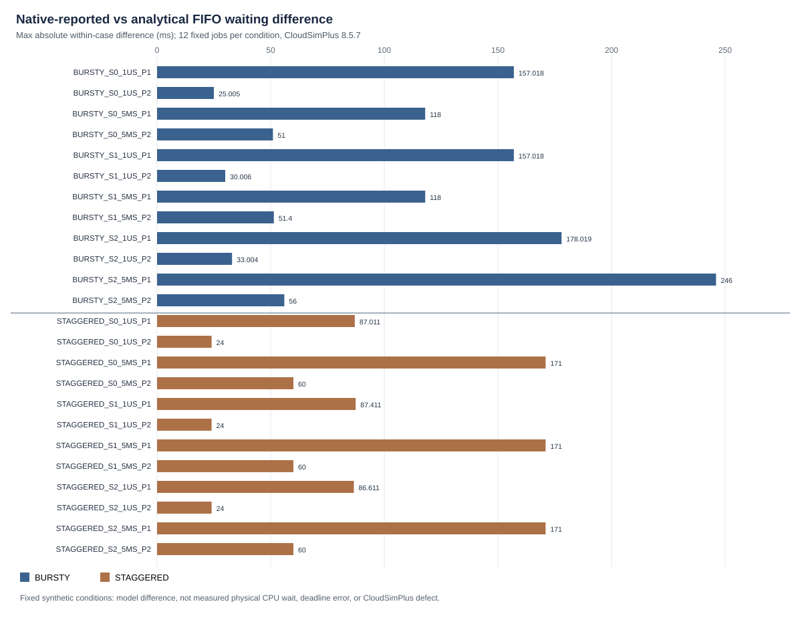

# Queue-Wait and Execution-Time Semantics in CloudSimPlus 8.5.7: Implications for IoT Scheduling Simulation

## Abstract

IoT-oriented scheduling evaluations may rely on discrete-event simulators and analytical queue references to assess cloud or edge resource allocation. These models should not be assumed to share identical admission or timing semantics. We present an explicitly bounded, reproducible comparison of CloudSimPlus 8.5.7 SpaceShared scheduling with an event-independent, capacity-matched FIFO reference. Six native Java microcases identified two older-WAIT/younger-EXEC admissions; a predeclared in-sample rescan removed both with byte-identical controls. In eight new predefined synthetic cases, a before-admission event-state predicate identified two positive and six negative outcomes, while a predicted 5-ms-versus-1-μs event-gap difference failed. A separately preregistered 24-condition experiment varied two synthetic arrival families, three deterministic timing variants, two minimum-event intervals and one/two processing elements; all 288 Cloudlets completed. We compare native-reported waiting times with a FIFO recurrence driven by actual native submission timestamps. Across the 24 cases, the maximum within-case absolute wait discrepancy ranged from 24 to 246 ms; classifications at synthetic submission-plus-25-ms and plus-50-ms deadlines differed for 86/288 and 107/288 jobs, respectively. A retrospective check found native-reported execution duration differed from requested duration for 250/288 jobs; substituting those after-completion durations into the reference left an across-case maximum discrepancy of 154 ms. These are model-dependent observations for fixed synthetic, CPU-only, one-VM inputs that motivate caution when interpreting IoT scheduling simulations; they are not proof of an IoT deployment effect, simulator defect, general FIFO contract violation, scheduling-policy gain, or real-world deadline reliability.

**Keywords:** discrete-event simulation; Internet of Things (IoT); SpaceShared scheduling; CloudSimPlus 8.5.7; queue waiting; reproducibility.

## 1. Introduction

Simulation-based evaluations of cloud and edge scheduling often combine discrete-event execution traces with analytical queueing references. A comparison is interpretable only if the measured quantities share a defined time origin, admission rule, service-duration convention and completion event. Identical labels—such as waiting time or FIFO—do not establish that equivalence.

We examine this issue in an explicitly bounded setting: CloudSimPlus 8.5.7 SpaceShared scheduling of synthetic CPU-only Cloudlets on one VM with one or two processing elements (PEs). IoT motivates the need for careful deadline-aware simulation measurement, but the experiments use no IoT trace, physical device, network, or distributed placement policy. The objective is an auditable exact-version comparison of native measurements with a separately defined capacity-matched event-independent FIFO reference. Neither model is treated as a physical oracle, and disagreements are not presumed to be software defects.

The study addresses three research questions:

- **RQ1 — Measurement compatibility:** How do native reported queue waiting, execution duration and synthetic deadline classifications compare with a FIFO reference driven by actual native submission timestamps? Which accounting differences can be checked directly?
- **RQ2 — Event-phase observation:** In previously identified three-job microcases, what observed waiting-promotion and direct-admission sequence permits an older WAIT job to coexist with a younger newly admitted EXEC job, and what happens under a specifically declared after-update rescan?
- **RQ3 — Bounded new inputs:** Does a source-observable before-admission state predicate agree with outcomes in eight newly specified synthetic cases, and does the separately specified hypothesis of more anomalies with 5-ms than 1-μs event separation survive those cases?

For RQ1, a preregistered 24-condition experiment contains 288 completed jobs. RQ2 uses method-level event logs and an in-sample control/treatment comparison on six previously examined conditions. RQ3 tests eight prospectively fixed but purposively designed fixtures. Its input-only event-gap hypothesis fails; the phase-state predicate may substantially overlap the documented native admission condition. Follow-up per-job duration and threshold analyses are explicitly retrospective.

The contribution is a reproducible characterization of **where these two measurement constructions disagree, what recorded state supports a bounded event-phase explanation, and which explanations remain unverified**. Existing work already establishes the need to validate simulator models and resource-duration accounting. We do not claim a new general verification method, queueing theorem, scheduler, universal predictor or IoT performance result. A separate FGCS-oriented CASPER policy study is not a source of new results in this article; its exact publication status and appropriate overlap disclosure require author confirmation.

## 2. Related work

Simulation frameworks provide repeatable environments for studying provisioning and scheduling without full production deployment. Calheiros et al. [1] introduced the CloudSim modeling toolkit for cloud-resource experiments. Silva Filho et al. [2] subsequently documented CloudSim Plus as a modular, extensible simulation framework. Our use of CloudSimPlus does not imply that a generic analytical FIFO waiting-time model and the published SpaceShared implementation in version 8.5.7 share identical timing or callback semantics. The versioned API explicitly documents configurable minimum event separation [5] and separate cloudlet admission and processing-update interfaces [6].

Verification, reproducibility and model validation are distinct methodological questions. Sargent [3] discusses the validation of simulation models, including conceptual, operational and data validity. In distributed systems specifically, Casanova et al. [4] present the SimGrid framework and study the accuracy/scalability tradeoffs of models used for distributed-platform experiments. Thus, generic claims that simulation assumptions matter would duplicate well-established work. The potentially incremental contribution here is the **reproducible, version-specific characterization of particular native task admission/processing-accounting behaviors and the quantitative consequences of comparing those measurements to a declared capacity-matched FIFO reference**.

The separate earlier FGCS-oriented CASPER manuscript describes the uncertainty-aware routing algorithm, certificates, health/probe mechanisms and limitations of queue estimation and selected-node feedback. The present research does **not** introduce those mechanisms and must not reclaim their original algorithm, task model or numerical evaluations. Its experiments use new isolated native simulator fixtures to examine operational queue semantics and synthetic deadline-classification disagreements. It is a simulator-measurement case study rather than an evaluation of a new scheduling policy or a distributed computing deployment.

**Closest direct prior art and difference.** Vondra, Šedivý and Castro [7] reported inaccuracies in job-duration calculation in a modified CloudSim/CloudAnalyst setting for autoscaling. Their finding makes clear that service-duration-accounting problems in CloudSim-family simulations are **not new as a general problem**. Zakarya and Gillam [8] (the accessible full manuscript, especially §4.1, §5 and §6) compare extended CloudSim CPU/host-heterogeneity models with analytical/statistical and testbed-derived references, as well as actual workload traces. Their work explicitly predates our use of an analytical model to interrogate simulation validity and includes more externally grounded resource validation than the fixed synthetic experiment here. However, their central questions are platform/VM heterogeneity, migration, energy and allocation accuracy—not an exact version-locked 8.5.7 SpaceShared Cloudlet submit/WAIT/EXEC sequence or source-defined start-wait accounting. An independent simulator-comparison study [9] evaluates modeling accuracy against micro-datacenter performance. Separately, Vondra and Šedivý [12] already use a queueing-network simulation approach for cloud autoscaling, motivated by limitations of earlier CloudSim simulations; they substitute a queue-theoretic autoscaling model rather than audit native CloudSimPlus 8.5.7 callback and reported waiting-time semantics. The full publisher paper [12] was not directly examined for this comparison; the distinction is limited to published abstract and accessible article synopsis. Sallo and Kecskemeti [10], in their open published full text (section 'Other simulators'), report that the CloudSim configuration they examined dispatched all tasks at the start of the simulation instead of honoring the submitted times in the converted serverless trace. Their paper primarily addresses trace generation, resizing, and conversion, not native v8.5.7 SpaceShared scheduling. We do not generalize that version-specific observation to the software used here: the A3 control found matching datacenter and scheduler-submit clocks for all 288 of our fixed jobs. These studies establish both relevance and a substantial overlap boundary: our study cannot claim invention of model-to-analytical comparison, discovery that duration accounting matters, or first observation that event/arrival handling affects simulator outputs.

What is different in the present work is its *specific executed evidence*: version-locked 8.5.7 SpaceShared scheduler callbacks, native same-submit waiting/execution list snapshots, passive-observer control, and a prespecified full 24-cell synthetic factorial with capacity-matched FIFO and a labeled after-completion service-duration sensitivity calculation. This is a **new dataset/measurement protocol for a particular configuration**, not automatically a novel general methodology. The official SpaceShared API documents exclusive PE admission and a waiting list, but does not guarantee equivalence to our event-independent FIFO server recurrence [6]. Accordingly, our main result is framed as **measured disagreement between two clearly defined execution-accounting models**, not an implementation contract violation or proof of library error.

**Scope and originality boundary.** Studies of CloudSim resource-duration accuracy, analytical model comparisons, and submit-time handling predate this research [7,8,10]. The direct contribution is limited to the new, reproducible 8.5.7 native-event observations and their bounded factorial comparisons. No networked multi-node experiment, field deadline study or new policy result is claimed. Sufficiency of this narrow versioned empirical diagnostic as a full original *Simulation Modelling Practice and Theory* article remains to be established. The directly inspected closest methods, scope limits and publication risks are documented in the [SIMPAT-oriented direct-source comparison](SIMPAT_DIRECT_ZAKARYA_AND_VONDRA_PRIOR_ART_2026-11-18.md).

The present comparison is specific to CloudSimPlus 8.5.7 SpaceShared execution: earlier analytical and simulation validation papers [4,7–10] establish the broader methodology and show that neither task-duration accounting nor arrival-time interpretation is a novel generic issue. The separate FGCS-oriented CASPER manuscript describes a distinct routing policy and related queue-model caveats, which this study does not reuse as new contributions.

Direct-text review of [8] also reinforces an important difference in evidence strength: whereas their validation uses real traces and testbed-related reference evidence, the current work is deliberately a controlled fixed synthetic software-measurement case. A matching analytical versus native simulator number here would not establish fidelity to an external physical system; nor does a difference necessarily prove the native simulator wrong. 

**Direct comparison with the target journal's simulator-quality study.** We examined the publicly available author-uploaded full text of Mechalikh et al. [11]. Their study compares 24 *different edge simulation frameworks*, including CloudSim Plus (§5.1.2), based on functionality, maintainability, software quality and scalability/reliability-related criteria; their §6 benchmark and software metrics are principally simulator-level properties rather than per-job scheduling timing in a fixed-version runtime. The current study instead examines 24 *configurations of a single CloudSimPlus 8.5.7 SpaceShared runtime* and uses native Java callback/log evidence to compare reported per-job waiting and execution durations with a declared FIFO m-server reference. These two sets of 24 are not equivalent sample units. Our empirical measurement is narrower, and the present work does not replicate or supersede their simulator-selection taxonomy. This is a direct, bounded difference in the evaluated construct; it does not establish a general first-in-literature claim or automatically demonstrate that a small one-VM methodological study meets this journal's novelty threshold [11].

## 3. Models and measurement definitions

**Time-origin validity.** Publisher CloudSimPlus 8.5.7 source `CloudletAbstract.java` lines 253–256 defines `getStartWaitTime()` as the difference between `getStartTime()` and `dcArrivalTime` when the latter is assigned. The A2 FIFO reference instead initializes from the actual scheduler `cloudletSubmitInternal` timestamp. Because these origins are not generally interchangeable, an independent, version-specific A3 Java control measured them directly. On this fixed 24-case workload they coincide for 288/288 jobs; this cannot be generalized beyond the test configuration.

### 3.1 Native simulator

We run Java 17 with the published CloudSimPlus 8.5.7 binary. Each simulator case has a single SpaceShared VM with either one or two processing elements (PEs), sufficient host capacity and CPU-only one-PE Cloudlets. The native scheduler generates its own event updates and reported start-wait accounting. We record actual submit callback order and timestamps, the execution and waiting lists immediately surrounding task submission, the completion callback clock, native reported wait, and native total execution duration.

### 3.2 Defined FIFO reference (not a surrogate ground truth)

For each case, the reference takes the **actual observed native task submission timestamps** and their actual submission order. All jobs request one PE, and the reference has m identical FIFO servers, where m is the native VM PE count (1 or 2). At each submission in observed order, assign the job to the earliest available server, breaking a server tie by server index; set its start to the later of actual submission and that server’s next-free time, then advance that server by the task’s original requested CPU duration. FIFO reference waiting time is this computed start minus observed submission.

**Explicit reference recurrence.** Let the native submit callbacks supply task indices \(j_1,\ldots,j_n\) in their observed order, native submit times \(a_{j_k}\), requested CPU service durations \(p_{j_k}\), and VM capacity \(m\in\{1,2\}\). Initialize \(F_q=a_{j_1}\) for each FIFO server \(q=1,\ldots,m\). For \(k=1,\ldots,n\), select \(q_k=\arg\min_q(F_q,q)\), where ties use the smallest index; set \(B_{j_k}=\max(a_{j_k},F_{q_k})\), \(W^{FIFO}_{j_k}=B_{j_k}-a_{j_k}\), and update \(F_{q_k}=B_{j_k}+p_{j_k}\). The reference completion is \(C^{FIFO}_{j_k}=B_{j_k}+p_{j_k}\). This is a capacity-matched analytical list-scheduling/FIFO-server abstraction; it is **not** an asserted exact representation of every broker/SpaceShared operation, task priority, callback timestamp or native CPU start event. The retrospective sensitivity version replaces \(p_j\) by the *post-completion native-reported* duration \(\tilde p_j\) and is therefore descriptive rather than schedulable.

Because the analytical recurrence and the native scheduler differ by construction in their event processing and service accounting, **nonzero model disagreement is not in itself surprising or evidence of defect**. The measured scientific quantity is the magnitude and configuration sensitivity of disagreement under fully specified, auditable inputs—not a proof that either model is inherently correct. The reference is not a validated oracle for actual IoT timing.

The reference intentionally omits native CloudSimPlus callback cadence and execution-time accounting. Therefore, a difference between the two traces indicates a **difference between model semantics as defined**, not a measured library defect or a proof that either model is the physically correct scheduler. A second, explicitly **posthoc diagnostic reference** reruns the exact same FIFO assignment calculation with the native *total execution duration* of each job substituted for requested service. Those durations are only available after completion, so this reference is a sensitivity oracle, not a practical online scheduler or a causal decomposition.

### 3.3 Waiting and deadline-classification outcomes

The primary per-case outcome is the maximum across 12 jobs of the absolute discrepancy between native reported waiting and reference waiting (milliseconds). Secondary outcomes are mean absolute and mean signed waiting differences. Deadline classifications are compared at two preregistered sensitivity thresholds: the actual observed native submit time plus 25 ms and plus 50 ms. Native completion is the CloudSimPlus finish-callback timestamp; FIFO completion is defined by reference start plus requested service. These are **two distinct completion-time constructions**, and disagreement in the threshold classification is not a measured error rate against real deadlines. The thresholds are synthetic analytical margins, **not observed IIoT service-level objectives**.

## 4. Experimental design and reproducibility

### 4.1 Six-case dynamic admission diagnosis

The microcase uses three fixed nominal CPU service requests of 8.099623, 4.730689 and 9.120283 ms, with the third nominal arrival offset at 4.0997406, 8.0997406 or 18.0997406 ms. Each is crossed with minimum event times 1 microsecond or 5 milliseconds. The native scheduler’s method-level execution-eligibility callback is logged by a passive subclass that invokes the original superclass method exactly once and records its returned decision; original admission and update callbacks are also logged. We compare the instrumented and original Java runs after filtering the added callback-only trace rows.

The [actual successful A1 CI run](https://github.com/afshinyaghoobi/casper-iiot-cloudsim/actions/runs/44214864810) yielded six complete cases, 18/18 finished jobs and 54 observed eligibility callbacks. A later-submitted job joined the native execution list while an earlier-submitted job remained waiting only in ORIGINAL_5MS and LATE10_5MS. The extra callback logger did not change the original source trace under this comparison. A method-level waiting-promotion callback was not directly instrumented; we therefore do not identify the unique causal branch responsible for all bypass observations.

### 4.2 Prospective 24-case generalization

The [frozen A2 protocol](JPDC_A2_BOUNDED_GENERALIZATION_PREREG_2026-11-17.md) predates the actual final successful A2 Java run. Two deterministic synthetic workload families are considered: STAGGERED (12 nominal arrivals every 3 ms) and BURSTY (four groups of three arrivals every 12 ms). Requested service durations are [8, 13, 5, 19, 7, 11, 17, 6, 14, 9, 16, 10] ms; the three predeclared variants adjust arrivals with fixed submillisecond jitter. These factors are crossed with minimum event intervals of 1 microsecond or 5 milliseconds and native VM capacities of one or two PEs. The resulting 2 × 3 × 2 × 2 factorial comprises **24 cases and 288 Cloudlets**. The three variants are *deterministic sensitivity configurations*, not independently sampled real workloads.

The [actual A2 Java CI run](https://github.com/afshinyaghoobi/casper-iiot-cloudsim/actions/runs/44215741883) completed 288/288 jobs and the native log reproduced byte for byte. Two separate Python implementations recomputed reference waiting and deadline classifications from the original native log and passed. Both earlier unsuccessful A2 CI attempts remain archived: one revealed a Java generic-type compile issue; another completed simulation but failed in CSV audit parsing. Those defects were corrected without changing the frozen experimental workload.

### 4.3 Reproducible source-to-figure analysis and assisted script preparation

All main A2 numerical outcomes were computed from original native Java runs under a fixed prospective workload protocol. The original log, two separate reference-calculation audits, version-locked Java harness, exact analysis inputs, and GitHub Actions run identifiers are preserved in the repository. In particular, the per-task native finish and waiting-time values are parsed from the original archived native log; submission timestamps and submit order are used directly to calculate the m-server FIFO reference. The 24-row primary case table and vector plot are generated from the audited outputs and checked in a separate static cross-artifact CI job. The retrospective native-duration sensitivity and A3 timestamp-origin measurement are explicitly distinct *after-outcome* audits, not preregistered independent performance evidence.

AI-assisted tools were used to support manuscript and computational-script development, while execution of the version-pinned Java experiments, archival of original results, and reproduction/audit checks were performed as recorded in the public project repository. The final author-reviewed description and any mandated declaration will specify the tools and their roles in accordance with the target journal's publisher policy; this draft must not be submitted until the responsible authors have verified this disclosure and the code-derived results. Importantly, reproducible code and repeatable logs establish trace-level consistency for the specified simulator, not empirical fidelity to deployed IoT hardware.

## 5. Results

The results below are grouped in execution-history subsections to keep original A1/A2/A3 and later source-controlled derivations traceable; this table identifies their **research-question role and evidence status**, so posthoc analyses cannot be mistaken for independent prospective experiments.

| Research question | Evidence and primary comparison | Outcome | Evidentiary boundary |
|---|---|---|---|
| RQ1: native vs declared FIFO semantics | A2 24 configurations /288 Cloudlets; native Java timestamps vs event-independent capacity-matched FIFO | Across-case maximal within-case absolute waiting gap 246 ms; synthetic +25/+50-ms model classification disagreements 86/288 and 107/288 | Distinct models and no real deadlines; service accounting differs for 250/288 tasks; posthoc 51-threshold sweep is sensitivity only |
| RQ1: clock source | A3 independently instruments datacenter-arrival and scheduler-submit in matching A2 cases | 288/288 coincide at logged precision | Only those fixed configurations |
| RQ2: executed event-phase dynamics | Six known A1 microfixtures + 8.5.7 executed waiting-promotion method trace | 33 method calls, 10 with WAIT-to-EXEC transitions; two fixed cases exhibit younger direct EXEC while older WAIT | Already documented native paths; list membership is not physical CPU start |
| RQ2: bounded rescan | Predeclared intervention on six **previously observed** fixtures; full byte-identical original control | Pattern removed in both preknown positive cases; four negatives remain negative | Modified scheduler, not an independent held-out causal mechanism or bug proof |
| RQ3: new input pre-submit P | Eight newly frozen, three-job synthetic fixtures under unmodified native scheduler | TP2, FP0, TN6, FN0 within the eight designed cases | Source-state P is close to native admission capacity check; not population 100% predictive accuracy |
| RQ3: 5-ms vs1-μs input-only direction | Four paired new input families | **Negative:** 1/4 positives at each event gap | Predeclared monotone spacing hypothesis not supported |

### 5.1 RQ1 — Native timing, FIFO comparison and measurement confounds

The prespecified A2 factorial comprises 24 deterministic synthetic conditions (288 completed Cloudlets) and a separately defined capacity-matched FIFO reference using actual native submission times. The primary outcome is the within-case maximum absolute difference between simulator-reported start-wait and requested-service FIFO wait. The same job identities are used to compare completion-based classifications at the originally specified *synthetic* submit+25-ms and submit+50-ms thresholds.

The complete [verified A2 table](JPDC_A2_BOUNDED_GENERALIZATION_VERIFIED_2026-11-17.md) reports all 24 cells. Case-level maxima of absolute native-reported versus FIFO-reference waiting discrepancy ranged **24.0–246.0 ms**. The largest discrepancy (246 ms) occurred in the BURSTY_S2_5MS_P1 case. Across the 12 STAGGERED cells, the median of within-case maxima was **73.3055 ms** (range 24–171 ms); for the 12 BURSTY cells, the median was **87.0 ms** (range 25.005–246 ms). Across the 288 fixed job-condition observations, the average absolute wait difference, calculated from the per-case means weighted equally across 12 jobs each, was **49.0961 ms**. These summaries describe the designed fixed conditions and must not be interpreted as random-population estimates.

**Figure 1.** All 24 prespecified synthetic cases. Each bar shows the maximum, over 12 jobs in that case, of the absolute difference between native-reported waiting and the event-independent requested-service FIFO reference. This is a difference between two models, not a simulator defect or physical latency error.

The figure and its [stable tabular source](manuscript_a2_primary_24_cases_2026-11-18.csv) are committed alongside the manuscript. The original [GitHub Actions source-derivation record](https://github.com/afshinyaghoobi/casper-iiot-cloudsim/actions/runs/44217510468) independently produced a 24-case editable figure and complete table from the pinned A2 audit.

With deadlines defined as native actual submit time plus 25 ms, the native and reference models disagreed on **86/288 paired job classifications**. At plus 50 ms they disagreed for **107/288**. These descriptive counts use repeated deterministic configuration variants; they are neither independent Bernoulli evidence for inferential testing nor evidence of field application deadline error.

**Table 1.** Original preregistered 24-condition A2 native-versus-requested-FIFO model comparison. The maximum absolute wait difference is computed among 12 jobs per fixed case; deadline columns count *differences between models*, not observed physical deadline errors.

| Case | Maximum absolute waiting difference (ms) | Different +25 ms classifications (of 12) | Different +50 ms classifications (of 12) |
|:--|--:|--:|--:|
| BURSTY_S0_1US_P1 | 157.018 | 1 | 3 |
| BURSTY_S0_1US_P2 | 25.005 | 5 | 3 |
| BURSTY_S0_5MS_P1 | 118 | 1 | 3 |
| BURSTY_S0_5MS_P2 | 51 | 6 | 8 |
| BURSTY_S1_1US_P1 | 157.018 | 1 | 3 |
| BURSTY_S1_1US_P2 | 30.006 | 5 | 3 |
| BURSTY_S1_5MS_P1 | 118 | 1 | 3 |
| BURSTY_S1_5MS_P2 | 51.4 | 6 | 8 |
| BURSTY_S2_1US_P1 | 178.019 | 3 | 5 |
| BURSTY_S2_1US_P2 | 33.004 | 2 | 4 |
| BURSTY_S2_5MS_P1 | 246 | 2 | 5 |
| BURSTY_S2_5MS_P2 | 56 | 5 | 5 |
| STAGGERED_S0_1US_P1 | 87.011 | 4 | 5 |
| STAGGERED_S0_1US_P2 | 24 | 4 | 2 |
| STAGGERED_S0_5MS_P1 | 171 | 2 | 4 |
| STAGGERED_S0_5MS_P2 | 60 | 6 | 7 |
| STAGGERED_S1_1US_P1 | 87.411 | 4 | 5 |
| STAGGERED_S1_1US_P2 | 24 | 4 | 2 |
| STAGGERED_S1_5MS_P1 | 171 | 2 | 4 |
| STAGGERED_S1_5MS_P2 | 60 | 6 | 7 |
| STAGGERED_S2_1US_P1 | 86.611 | 4 | 5 |
| STAGGERED_S2_1US_P2 | 24 | 4 | 2 |
| STAGGERED_S2_5MS_P1 | 171 | 2 | 4 |
| STAGGERED_S2_5MS_P2 | 60 | 6 | 7 |
| **All 24 cases** | **Across-case maximum: 246** | **86/288** | **107/288** |

**Time origin and service-accounting checks (A3 and retrospective A2).** These assessments address distinct measurement assumptions and must not be presented as a general causal explanation.

A targeted **passive, exact-version 24-case A3 Java re-execution**, using the frozen A2 input cases, independently recorded each Cloudlet's Datacenter arrival, native execution start, native waiting and completion. Exact publisher 8.5.7 source establishes that `getStartWaitTime` equals the native start timestamp minus the Datacenter arrival timestamp. In the new real native [A3 run 44228414078](https://github.com/afshinyaghoobi/casper-iiot-cloudsim/actions/runs/44228414078), **0 of 288** jobs had a Datacenter-arrival timestamp differing from the observed original scheduler-submit callback clock at the reported resolution (maximum absolute difference **0.0 ms**). The source-defined wait identity held in all 288 jobs. Accordingly, the 24-case maximum native-vs-requested-FIFO waiting discrepancy remains **246 ms** when native wait is expressed as submit-to-native-start.

After removing A3 clock-only trace rows, new A3 instrumented execution was byte-identical to an independently rerun uninstrumented original A2 Java program. The full A3 trace repeated byte-for-byte after a logging-order fix. The earlier A3 attempt failed repeat comparison because two separate finish listeners emitted the same job's two observation records in inconsistent relative order; both observations are now emitted in a single listener. This is an instrumentation ordering issue, not evidence of different native scheduling outcomes. Full provenance: [A3 source and numerical audit](JPDC_A3_NATIVE_TIME_ORIGIN_VERIFIED_2026-11-17.md).

This rules out different measured Datacenter arrival and scheduler submit origins as a cause **for these specific 24 synthetic cases only**. It does not isolate service-duration accounting, waiting-list promotion or event cadence as the sole cause, nor establish a CloudSimPlus bug, a general physical CPU start or a real deadline effect.

The original A2 reference uses requested task execution durations. Our review of the archived native Java logs identified a critical accounting difference: **250 of 288** Cloudlets had total execution duration reported by the native simulator different from the originally requested service by more than 1e-6 ms. To assess whether that difference could explain the reported waiting discrepancy, we conducted a separately labeled **retrospective** FIFO recomputation, using each job's native-reported total execution duration as a hindsight service oracle. The across-case worst of the 24 maximum absolute waiting residuals decreased from **246 ms** to **154 ms**; however, **all 24 cases** still had a maximum absolute waiting residual above **1 ms**. The deadline-classification disagreements under the after-completion service oracle were **58/288** at submit+25ms and **78/288** at submit+50ms, versus **86/288** and **107/288** under the original requested-service reference.

The native `getTotalExecutionTime()` value is a **simulator-reported quantity**, not an independently measured physical CPU service demand. Substituting that after-completion quantity into an event-independent FIFO recurrence cannot recreate all event updates or identify which operation caused a wait difference. These calculations use the same spent native outputs, not independent confirmation. The hindsight oracle can make the residual worse in individual cells because altered service durations change subsequent reference waiting and server allocation. Differences between the two global maxima must **not** be reported as a causally isolated fraction of the waiting gap explained by service inflation. The finding supports a narrower conclusion: reported execution service accounting is a substantial model-comparison confound, but duration accounting alone is insufficient to reconcile native wait with event-independent FIFO within the tested 24 configurations.

Full retrospective protocol, source artifact lineage and 24-case calculation: [A2 service-duration report](JPDC_A2_NATIVE_SERVICE_ORACLE_RETROSPECTIVE_VERIFIED_2026-11-17.md); successful [CI run 44216958536](https://github.com/afshinyaghoobi/casper-iiot-cloudsim/actions/runs/44216958536).

**Additional exploratory measurement comparison.** In the original A2 BURSTY_S0_1US paired cases, moving from 1PE to 2PE reduced maximum absolute waiting discrepancy from **157.018 to 25.005 ms**, while increasing synthetic +25-ms deadline classification disagreements from **1/12 to 5/12**. This is an observed reversal in two *model-disagreement metrics*, not evidence that more PEs worsen real-world performance. A subsequent **posthoc** 51-offset sensitivity audit found that the descriptive PE-group disagreement pattern depends on the arbitrarily chosen deadline threshold; the full analyses and caveats are preserved in [Supplementary Sections S2–S3](SIMPAT_V24_SUPPLEMENTARY_EXTENDED_RESULTS_2026-11-18.md).

### 5.2 RQ2 — Direct admission, waiting-promotion and an in-sample intervention

In the original six native A1 microcases, **two** fixed conditions showed a younger submitted job entering `EXEC` while an older job remained in `WAIT`, observed as *scheduler list membership*, not as confirmed physical CPU start. Method-level follow-up on those already known fixtures identified **33** native waiting-promotion method calls, of which **10** included at least one WAIT-to-EXEC transition. Passive instrumented traces retained byte-identical stock controls after removing trace-only lines. A posthoc executed-event reconstruction observed an eligibility check that left the older job waiting before a later direct submit admitted the younger job. These documented source paths and timing states are not an undisclosed bug or a general FIFO contract violation.

The intervention protocol was frozen *after* the positive A1 conditions were known but *before* treatment execution: one extra waiting-promotion rescan immediately after a completed processing update. The altered treatment removed the specific older-WAIT/younger-EXEC list-state pattern in both previously positive cases; the four negative cases remained negative. The treatment ran **12 added rescan calls** across the six cases, and both arms completed all **18** jobs. The intervention deliberately changes scheduling behavior; it does not independently establish that the stock scheduler is wrong or explain all A2 residuals. Full numerical timestamps, traces, control equivalence, and failure qualifications are retained verbatim in [Supplementary Sections S1, S4–S6](SIMPAT_V24_SUPPLEMENTARY_EXTENDED_RESULTS_2026-11-18.md).

### 5.3 RQ3 — New synthetic fixtures, source-state agreement and failed input-only prediction

Eight additional prespecified but purposively designed three-job input fixtures were executed with unmodified CloudSimPlus 8.5.7 SpaceShared scheduling; all **24** jobs completed, with byte-identical native repeats. The frozen before-admission source-state predicate matched the two positive and six negative observed list-level admission labels (**TP=2, FP=0, TN=6, FN=0**), but conditions on immediately prior native queue state and may closely mirror a documented free-capacity admission rule. This is not demonstrated population-level prediction accuracy or a new scheduling algorithm.

The separate prespecified **input-only** directional hypothesis that 5-ms minimum event separation would yield more such cases than 1-μs separation **FAILED**: **1/4** positive in each interval group. This negative observation is part of the primary RQ3 report, not a removable outlier or proof of no event-gap effects elsewhere. Original fixture definitions, source-level P conditions, all eight outcomes and the negative-H interpretation are retained in [Supplementary Section S7](SIMPAT_V24_SUPPLEMENTARY_EXTENDED_RESULTS_2026-11-18.md).

## 6. Discussion

**What the comparison establishes.** The original 24-case A2 study and the source-matched A3 audit demonstrate reproducible differences between CloudSimPlus 8.5.7 native-reported timing and a specified event-independent, capacity-matched FIFO construction. A3 finds matching datacenter-arrival and scheduler-submit origins for the 288 fixed jobs at logged precision, eliminating one possible origin mismatch *in these conditions*. However, native-reported execution duration differs from requested service for 250/288 jobs. The retrospective native-duration substitution reduces the across-case maximum wait discrepancy but does not remove it. This is not a causal decomposition: the hindsight service values are not inputs available before execution, and changing them also changes subsequent reference server availability.

**Why event phases matter, and what remains unidentified.** The official versioned SpaceShared/Abstract scheduler documentation already specifies separate submission admission and waiting-list promotion paths [6]; it does not guarantee universal global FIFO service across all callback phases. A1 directly observed a phase-state sequence with older WAIT/younger EXEC membership in two known fixtures. A predeclared rescan intervention removed that list-level pattern in those same fixtures, with byte-identical controls. These observations show sensitivity to phase handling within the tested conditions, not a library bug, an independent held-out causal mechanism, or a physical CPU-start measurement. A2 lacks the comprehensive method-level instrumentation needed to assign its entire wait discrepancy to those A1 paths.

**Bounded new-input and negative evidence.** In eight later, purposively designed, previously unexecuted inputs, the frozen before-admission source-state predicate matched two positive and six negative outcomes. Because the predicate observes immediately relevant native queue and eligibility state, its agreement can be close to the published capacity/admission logic rather than a novel predictor. Crucially, the separate input-only prediction of more bypass patterns at 5 ms than at 1 μs failed (one of four at each interval). This negative observation rules out that particular simple directional claim within the fixed input families; it does not prove event separation has no effect in other workloads.

**Measurement consequence rather than policy ranking.** Across fixed A2 cases, the maximum absolute waiting-model difference need not rank configurations in the same order as thresholded native/FIFO completion-disagreement counts. For example, the exploratory BURSTY_S0_1US 1PE-to-2PE comparison reduces the maximum waiting discrepancy while increasing disagreement at the artificial +25-ms threshold. Retrospective threshold sweeps further show how a chosen cutoff changes the comparison. These are differences between two modeled measurement constructs, not real deadline misses, resource-capacity performance benefits or failures, or statistically generalizable effects.

**Practical implication and limit of originality.** Studies using analytical waiting predictors alongside event-driven IoT-oriented schedulers should report the scheduler version, actual task submission order and clock, PE capacity, waiting-list admission/promotions, requested versus reported service convention, and the exact completion/deadline construct. A simplified FIFO comparison is useful when presented as such; it is not an external truth standard. Prior simulation validation and CloudSim-duration work [3,7,8,12] already addresses the broad methodological problem. The incremental value here is a version-specific, archived diagnostic case with directly inspectable traces and an explicit failed hypothesis. Demonstrating a transferable new validation method or fidelity to deployed IoT timing would require different, independent evidence.

## 7. Threats to validity

**Model construct.** All workloads are deterministic and synthetic: the A1 microfixtures use one VM PE, while the A2 grid includes **one- and two-PE VM configurations**. No actual network transfers, physical hardware contention, factory task traces, real deadline requirements or power measurements were studied. The declared reference is an abstraction, and native-reported total execution differs from requested work under event processing.

**Internal attribution and execution-time confounding.** The original **24-case A2** run observed submission and completion outcomes but did **not** instrument every internal `updateProcessing` or waiting-promotion callback; it therefore cannot causally attribute all requested-service FIFO residuals to internal phase ordering. Separately, the later six-case **A1** native microfixture did instrument and record actual waiting-promotion method invocations, and a subsequent controlled, in-sample post-update rescan intervention changed the observed two-case list-ordering state. The intervention deliberately changes scheduler behavior and can affect downstream events, so it cannot establish an otherwise unobserved physical service history or uniquely attribute the **A2-wide** discrepancies to one method. Native-reported total execution differs from requested work for 250/288 A2 jobs. Callback cadence, phase-dependent admission and execution-duration accounting remain confounded for A2; none of this proves a library defect.

**Software-contract and intervention scope.** Version-pinned Javadocs already describe suitability-based WAIT promotion and exclusive-PE allocation [6], but they do not establish the general FIFO reference used here as a normative correct implementation. A treatment-side extra rescan is a **change of scheduler behavior**, not an unbiased observer or proof that the stock library is wrong. The two affected A1 conditions were known before the treatment protocol was frozen; repeatability and exact control parity do not create independent out-of-sample validation.

**New-input evidence and possible near-tautology.** The additional eight-case A1 test was frozen before executing those case inputs but designed using the previous six-case phenomenon, so it is not a representative or fully independent hypothesis-discovery sample. The before-admission state predicate includes the observed empty execution list immediately before direct submission; its successful eight-case label agreement may follow directly from the documented native eligibility operation, rather than identify a genuinely predictive simulation-method principle. The separate prespecified hypothesis that 5-ms event spacing gives more anomalies FAILED (one positive in each four-case spacing group). No interpretation may hide or reinterpret that negative result.

**Statistical validity.** Three fixed timing variants per family are not independent source-level population draws. The 288 jobs belong to 24 designed, correlated simulator configurations and should not be treated as independent inferential replicates. Descriptive ranges and counts are appropriate; stronger confidence claims require a new sampling design.

**External validity and novelty.** No performance claim transfers to deployed IoT gateways, edge devices or IIoT factories; the term IoT in the title identifies a motivated evaluation context, not a demonstrated IoT simulation workload or application result. This article is a simulator-methodology study, not a new CASPER scheduler paper. A distinct peer-reviewed related-work comparison and full overlap audit are required before submission.

## 8. Reproducibility and data availability

The exact-version CloudSimPlus 8.5.7 Java sources, original experiment configurations, analytical scripts, original 24-case A2 table and Figure 1 are publicly traceable in the project [CASPER IIoT CloudSim repository](https://github.com/afshinyaghoobi/casper-iiot-cloudsim). The originally completed A2 Java run is [44215741883](https://github.com/afshinyaghoobi/casper-iiot-cloudsim/actions/runs/44215741883), source commit `31a4acf167078ccbb255f01034630bca64ce40e8`, original downloadable workflow artifact ID 14387238746, original ZIP SHA256 `1d29943e5e48d27f65eed186df23ff22d3dd7bdab381ebe63fca88dba1e3bb4b`.

**Raw source evidence is now also committed directly to the Git repository**, not merely referenced by potentially expiring workflow artifacts. Original native A2 (288-job), A3 clock-origin, A1 six-case waiting-promotion, A1 controlled rescan-treatment and eight newly configured A1 cases are in the [verified version-pinned original-log directory](https://github.com/afshinyaghoobi/casper-iiot-cloudsim/tree/95424c68d8e3824c76c0a249cec6b0c5e3491184/jpdc/evidence/simpat_v857_original_2026-11-18), with the associated original audit JSON, retrospective 288-job native/FIFO margin CSV, the 51-threshold analysis CSV and `SHA256SUMS.txt`. The evidence was transferred from the **original** recorded GitHub Actions runs, independently checked against original SHA256 values and duplicate byte-equal runs, and committed under fixed evidence commit `95424c68d8e3824c76c0a249cec6b0c5e3491184`; the [original-data archival workflow run](https://github.com/afshinyaghoobi/casper-iiot-cloudsim/actions/runs/44406625844) passed all source hash, source control and negative-outcome checks. The original A2 native log SHA256 remains `9fb08d07fe9741772b0de59a837046d0152362d3724da04daf02ccbc3d879391`. For provenance and file-to-experiment mapping see the [archive README](https://github.com/afshinyaghoobi/casper-iiot-cloudsim/blob/jpdc-seed0-repro-20261024/jpdc/evidence/simpat_v857_original_2026-11-18/README.md).

GitHub Actions run artifacts may expire or become inaccessible, but their primary source-log bytes are now separately Git-tracked. **Git history is mutable and repository access can change**, so an independent immutable third-party data deposit and DOI have **not** been established. An archive DOI will only be stated after a real published deposit can be independently verified. These original-source checks establish within-configuration reproducibility, not accuracy for physical hardware or real IoT deployment.

## 9. Conclusion

For 24 deterministic CloudSimPlus 8.5.7 SpaceShared configurations and 288 completed synthetic CPU-only Cloudlets, native-reported waiting and synthetic deadline classifications differ from a separately defined capacity-matched event-independent FIFO reference. A3 confirms equal datacenter-arrival and scheduler-submit origins for these jobs at logged precision, while native-reported execution duration differs from requested service for 250/288 jobs. Retrospective service substitution leaves substantial model disagreement, but does not identify its unique cause. Exact-version A1 traces and an in-sample rescan demonstrate local phase-sensitive WAIT/EXEC admission behavior; an eight-fixture state-predicate check remains implementation-dependent, and the prospectively specified input-only 5-ms versus 1-μs directional hypothesis fails. The defensible result is a reproducible, bounded measurement case study that cautions against treating analytical FIFO and native event-driven timing as interchangeable. It does not establish a CloudSimPlus defect, general validation method, new scheduling policy, or real IoT deadline reliability.

## Declarations required before journal submission

**Authorship, funding, conflicts and overlap:** The author-approved title-page information, CRediT contributions, competing-interest and funding declarations, and any required editorial disclosure of the related FGCS CASPER submission must be added after the actual authors verify them. No approval or absence of funding/conflicts is assumed in this working copy.

**Declaration of generative AI and AI-assisted technologies in the manuscript preparation process — author verification required.** OpenAI ChatGPT has been used to support the drafting and revision of the manuscript, literature screening, and development or review of analysis and visualization scripts. The experiment and verification records are tied to the original native Java runs and audited output files as detailed in Methods. The final journal declaration must identify every AI tool actually used, distinguish manuscript preparation from code and research methods, and be finalized only after all authors have independently checked the manuscript and accepted full responsibility. This paragraph is an **unapproved draft**, not a claim that those author reviews have already occurred.

## References

[1] R. N. Calheiros, R. Ranjan, A. Beloglazov, C. A. F. De Rose, and R. Buyya, “CloudSim: a toolkit for modeling and simulation of cloud computing environments and evaluation of resource provisioning algorithms,” *Software: Practice and Experience*, 41(1), 23–50, 2011. https://doi.org/10.1002/spe.995

[2] M. C. Silva Filho et al., “CloudSim Plus: A cloud computing simulation framework pursuing software engineering principles for improved modularity, extensibility and correctness,” *IFIP/IEEE International Symposium on Integrated Network Management*, 2017. https://doi.org/10.23919/INM.2017.7987304

[3] R. G. Sargent, “Verification and validation of simulation models,” *Journal of Simulation*, 7(1), 12–24, 2013. https://doi.org/10.1057/jos.2012.20

[4] H. Casanova, A. Giersch, A. Legrand, M. Quinson and F. Suter, “Versatile, scalable, and accurate simulation of distributed applications and platforms,” *Journal of Parallel and Distributed Computing*, 74(10), 2899–2917, 2014. https://doi.org/10.1016/j.jpdc.2014.06.008

[5] CloudSimPlus version 8.5.7 API, Simulation core. https://javadoc.io/static/org.cloudsimplus/cloudsimplus/8.5.7/org/cloudsimplus/core/CloudSimPlus.html

[6] CloudSimPlus version 8.5.7 API documentation, *CloudletSchedulerSpaceShared* and *CloudletSchedulerAbstract*, including waiting promotion and `updateProcessing`. https://javadoc.io/static/org.cloudsimplus/cloudsimplus/8.5.7/org/cloudsimplus/schedulers/cloudlet/CloudletSchedulerSpaceShared.html ; https://javadoc.io/static/org.cloudsimplus/cloudsimplus/8.5.7/org/cloudsimplus/schedulers/cloudlet/CloudletSchedulerAbstract.html

[7] T. Vondra, J. Šedivý, and J. M. Castro, “Modifying CloudSim to accurately simulate interactive services for cloud autoscaling,” *Concurrency and Computation: Practice and Experience*, 29(10), e3983, 2017. https://doi.org/10.1002/cpe.3983

[8] M. Zakarya and L. Gillam, “Modelling resource heterogeneities in cloud simulations and quantifying their accuracy,” *Simulation Modelling Practice and Theory*, 94, 43–65, 2019. https://doi.org/10.1016/j.simpat.2019.02.003.

[9] D. Alshammari, J. Singer, and T. Storer, “Performance Evaluation of Cloud Computing Simulation Tools,” *IEEE ICCCBDA*, pp. 522–526, 2018. https://doi.org/10.1109/ICCCBDA.2018.8386571

[10] D. H. Sallo and G. Kecskemeti, “Enriching computing simulators by generating realistic serverless traces,” *Journal of Cloud Computing*, 2023. https://doi.org/10.1186/s13677-023-00397-8

[11] C. Mechalikh, A. E. H. Silem, Z. Safavifar, and F. Golpayegani, “Quality matters: A comprehensive comparative study of edge computing simulators,” *Simulation Modelling Practice and Theory*, vol. 138, art. 103042, 2025. https://doi.org/10.1016/j.simpat.2024.103042

[12] T. Vondra and J. Šedivý, “Cloud autoscaling simulation based on queueing network model,” *Simulation Modelling Practice and Theory*, 70, 83–100, 2017. https://doi.org/10.1016/j.simpat.2016.10.005
